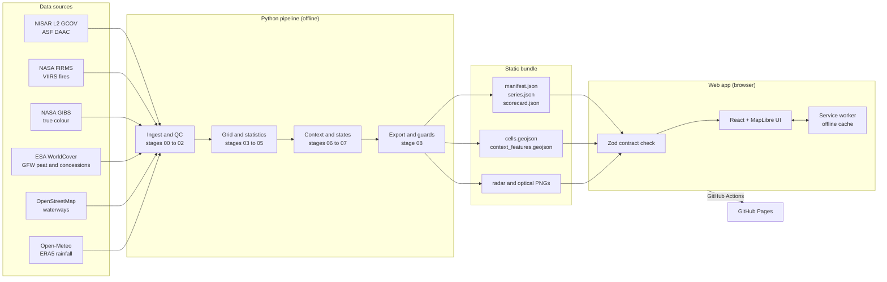
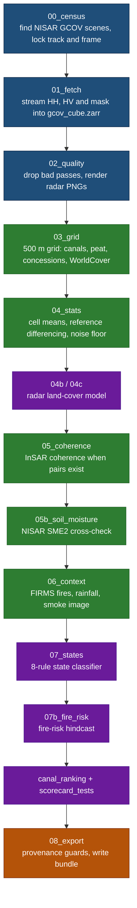
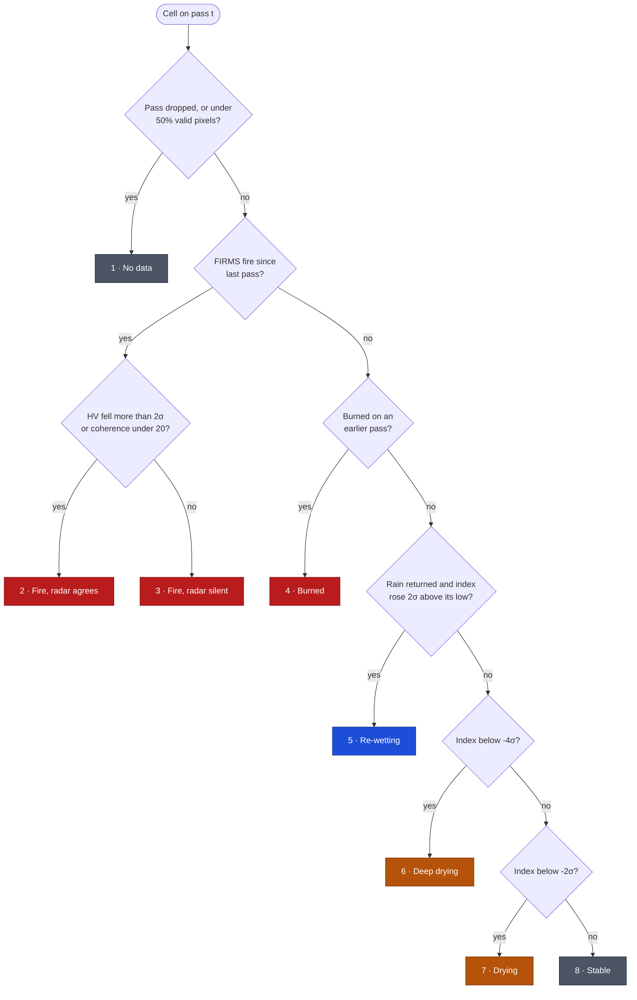
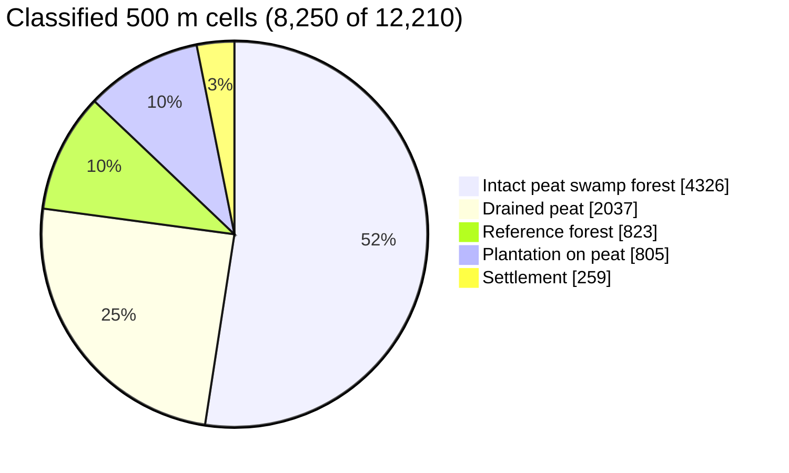
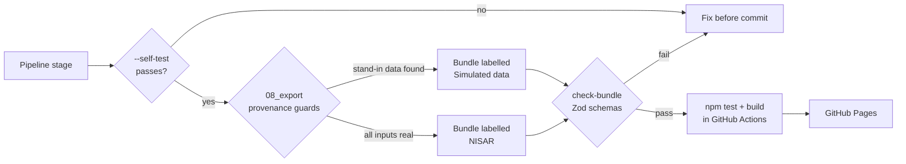

# Napas Gambut (*Peat's Breath*)

**When smoke hides the peat, NISAR still sees it.**

Napas Gambut is a peatland monitor for Central Kalimantan, Indonesia. It reads NISAR L-band radar every 12 days and shows, cell by cell, where peat is drying, re-wetting or burning, including during haze, when optical satellites see nothing.

Built by **Team Betelgeuse** for the NASA Space Apps Challenge 2026, challenge *Dancing with the SARs*.

[**Live app**](https://gothitbytrucksotruckman.github.io/NapasGambut/) · [Method](docs/method.md) · [Data contract](docs/data-contract.md) · [Models](docs/models.md) · [Sources](docs/sources.md)


---

## Contents

- [Why this matters](#why-this-matters)
- [What the app shows](#what-the-app-shows)
- [Project status](#project-status)
- [Architecture](#architecture)
- [Tech stack](#tech-stack)
- [Processing pipeline](#processing-pipeline)
- [How a cell gets its state](#how-a-cell-gets-its-state)
- [Study area and land classes](#study-area-and-land-classes)
- [Data sources](#data-sources)
- [Getting started](#getting-started)
- [Repository layout](#repository-layout)
- [Testing and quality gates](#testing-and-quality-gates)
- [Use of AI](#use-of-ai)
- [Team](#team)
- [License](#license)

---

## Why this matters

Peatlands cover 3 to 4% of the Earth's land but hold up to a third of its soil carbon ([UNEP, 2022](https://www.unep.org/en/news-and-stories/press-release/global-assessment-reveals-huge-potential-peatlands-climate-solution)). Drained peat dries out and burns underground. In 2015 Indonesia lost 2.6 million ha to fire and US$16.1 billion in damage, and peat fires produced most of the haze ([World Bank, 2016](https://doi.org/10.1596/23840)).

Restoration agencies and village fire brigades have to decide which canals to block before the next dry spell. During the fire season the sky is full of smoke, so optical imagery cannot tell them where the peat is drying. L-band radar can: its 24 cm wavelength passes through smoke and cloud and responds to surface moisture.

## What the app shows

| Screen | Purpose |
| --- | --- |
| **Smoke and radar** | Swipe between a smoky true-colour image and the radar view of the same day. |
| **Season map** | Plays every 12-day pass. Each 500 m cell is coloured by its state; a pulse card shows its wetness index against the noise band, with rain, coherence and fire counts. |
| **Scorecard** | Results by land type, canals to block first, dams to inspect, and the scientific self-checks. |
| **Method** | The method in plain language, its limits, and how AI was used. |
| **Global peat** | The large tropical peatlands NISAR revisits every 12 days. |

The app is bilingual (English and Bahasa Indonesia), keyboard accessible, respects `prefers-reduced-motion`, and works offline after the first visit.

## Project status

*As of 15 November 2026.*

| Component | Status |
| --- | --- |
| Web app (5 screens, EN/ID, offline) | Live on GitHub Pages |
| Data shown in the live app | Simulated season, labelled "Simulated data" on every screen |
| NISAR GCOV passes streamed from ASF | 2 of 10 (22 Jun and 4 Jul 2026) |
| 500 m analysis grid (OSM canals, GFW peat and concessions, ESA WorldCover) | Built from real data |
| BRGM PRIMS canal-dam points | Not available for this box, so no cell is classed "rewetted" |
| Pipeline self-tests | Passing on simulated inputs |

`08_export.py` refuses to write a real bundle until every kept pass comes from a live ASF stream. Once the remaining passes are processed, the app switches to real data with no code changes.

---

## Architecture

Heavy computation runs offline in Python. The browser only renders a small static bundle, so the site needs no backend and can be hosted for free.



Design rules that hold across the codebase:

- **The browser never recomputes science.** Every number on screen is read from the bundle.
- **One contract.** The bundle format is defined once in [`docs/data-contract.md`](docs/data-contract.md) and enforced by Zod schemas in [`src/contract/index.ts`](src/contract/index.ts). A bundle that fails validation is rejected before it reaches the UI.
- **Simulated data is always labelled.** A bundle with `data_kind: "mock"` shows a "Simulated data" badge on every screen.

---

## Tech stack

### Web application

| Layer | Technology | Version | Role |
| --- | --- | --- | --- |
| UI framework | React | 19.3 | Component rendering and state |
| Language | TypeScript | 7.0 | Static typing across app, scripts and tests |
| Build tool | Vite | 8.3 | Dev server and production build |
| Maps | MapLibre GL JS | 6.18 | Vector map, cell layers, raster overlays |
| Charts | d3-scale, d3-shape | 4.0, 3.2 | Pulse-card time series and scales |
| Validation | Zod | 4.6 | Runtime check of the data bundle |
| Typography | IBM Plex Sans, Serif, Condensed | 5.3 | Self-hosted fonts (no external requests) |
| Offline | Service Worker | n/a | Caches the app shell and bundle |
| Testing | Vitest, tsx | 5.1, 4.23 | Unit, contract, i18n and reading-level tests |

### Data pipeline

| Area | Libraries |
| --- | --- |
| Arrays and tables | NumPy 2.5, pandas 3.0, SciPy 1.18, PyArrow 26 |
| SAR cubes | xarray, Zarr 3.4, h5py, h5netcdf, fsspec, s3fs |
| Raster | Rasterio 1.4, rioxarray 0.18 |
| Vector and projection | GeoPandas 1.0, Shapely 2.0, pyproj 3.7, pyosmium 4.0 |
| Data access | asf-search 8.1, earthaccess 0.14, Requests |
| Machine learning | scikit-learn 1.9, MAPIE 1.6 (conformal sets), cleanlab 2.9 |
| Rendering and config | Matplotlib, Pillow, PyYAML, python-dotenv |

Pinned versions: [`pipeline/requirements.txt`](pipeline/requirements.txt) and [`package.json`](package.json).

### Infrastructure

| Concern | Choice |
| --- | --- |
| Hosting | GitHub Pages (static) |
| CI/CD | GitHub Actions: `npm ci`, `npm test`, `npm run build`, deploy on push to `main` |
| Secrets | `.env` (git-ignored): `EARTHDATA_TOKEN`, `FIRMS_MAP_KEY` |
| Projection | WGS 84 for the app, UTM zone 49S (`EPSG:32749`) for all area and distance work |

---

## Processing pipeline

Stages run in order. Each one reads the files written by the stage before it, and most have an offline `--self-test` that needs no data.



| Stage | Output |
| --- | --- |
| [`00_census.py`](pipeline/00_census.py) | `data/census.csv`, `data/selected_scenes.json` |
| [`01_fetch.py`](pipeline/01_fetch.py) | `data/gcov_cube.zarr` (marked `asf_live_stream` or `synthetic_dry_run`) |
| [`02_quality.py`](pipeline/02_quality.py) | `data/quality_report.json`, `bundle/images/radar_*.png` |
| [`03_grid.py`](pipeline/03_grid.py) | `data/grid_cells.parquet`, `data/grid_provenance.json`, `bundle/cells.geojson` |
| [`04_stats.py`](pipeline/04_stats.py) | `data/cell_stats.parquet`, `data/noise_floor.json` |
| [`04b_landclass_features.py`](pipeline/04b_landclass_features.py), [`04c_landclass.py`](pipeline/04c_landclass.py) | Per-cell radar features, conformal class sets, map-check flags |
| [`05_coherence.py`](pipeline/05_coherence.py) | `data/coherence.parquet` (empty when no GUNW pairs exist) |
| [`05b_soil_moisture.py`](pipeline/05b_soil_moisture.py) | `data/sme2_cells.parquet`, `data/sme2_report.json` |
| [`06_context_tabular.py`](pipeline/06_context_tabular.py), [`06_context_visuals.py`](pipeline/06_context_visuals.py) | `data/fires.parquet`, `data/context_summary.json`, smoke image |
| [`07_states.py`](pipeline/07_states.py) | `data/states.parquet` |
| [`07b_fire_risk.py`](pipeline/07b_fire_risk.py) | Fire-risk hindcast table and test result |
| [`canal_ranking.py`](pipeline/canal_ranking.py), [`scorecard_tests.py`](pipeline/scorecard_tests.py) | `data/canal_rankings.json`, `data/scorecard_tests.json` |
| [`08_export.py`](pipeline/08_export.py) | The app bundle |

All thresholds, the study box and output paths live in [`config.yaml`](config.yaml).

### The wetness index

For each cell, the index is the change in HH backscatter since the first pass, minus the same change over reference forest on mineral soil. Subtracting the reference removes changes that affect the whole scene, such as calibration or weather. Averaging is done in linear power before converting to decibels.

```text
D_t     = (HH_t - HH_0)_cell - (HH_t - HH_0)_reference
sigma_t = 1.4826 x MAD(D_t over reference-forest cells)
```

A cell is only labelled as changing when its index moves further than the noise floor `sigma_t` of that pass.

---

## How a cell gets its state

Rules are checked in order on every pass. The first rule that matches wins. Defaults: `change_k = 2`, `deep_k = 4`, `rain_return_mm = 50`.



"Fire, radar silent" is a finding, not an error. Low-intensity ground fires can leave the canopy standing, so the radar may not respond even when a fire was detected.

---

## Study area and land classes

The study box covers `113.75°E to 114.25°E, 2.25°S to 1.75°S`, part of the former Mega Rice Project area in Central Kalimantan. It is divided into a 500 m grid in UTM zone 49S (12,210 cells). Each cell is classified by six first-match rules using ESA WorldCover 2021, GFW peat and concession maps, and OpenStreetMap canals. Cells that match no rule (mostly mineral soil outside the peat dome) are dropped rather than given a catch-all class.



| Priority | Class | Rule |
| --- | --- | --- |
| 1 | Settlement | Built-up share ≥ 10% |
| 2 | Plantation | Concession share ≥ 50% |
| 3 | Rewetted | Peat ≥ 50%, has canals, dam within 1 km |
| 4 | Drained | Peat ≥ 50%, has canals or tree cover < 70% |
| 5 | Reference forest | Inside the reference box, peat ≥ 50%, tree cover ≥ 70%, no canals |
| 6 | Intact forest | Peat ≥ 50%, tree cover ≥ 70%, no canals |

Source: `data/grid_cells.parquet` produced by `03_grid.py`. The grid draws on 4,070 OpenStreetMap waterway segments; 2,028 cells contain at least one canal or drain.

---

## Data sources

### NASA

| Dataset | Use |
| --- | --- |
| NISAR L2 GCOV (NASA-ISRO, via ASF DAAC) | Core signal: 12-day L-band HH and HV backscatter |
| NASA FIRMS VIIRS 375 m | Active fire detections per cell and pass |
| NASA GIBS VIIRS true colour | Smoke image on the first screen |
| NISAR L2 SME2 (provisional) | Soil-moisture cross-check |
| NISAR L2 GUNW | Coherence, when interferometric pairs exist |
| MODIS MCD64A1 | Burned-area cross-check |

### Other

| Dataset | Use | Licence |
| --- | --- | --- |
| ESA WorldCover 10 m 2021 v200 | Tree cover and built-up share per cell | CC BY 4.0 |
| Global Forest Watch: Indonesia peat lands, oil-palm and wood-fibre concessions | Peat and concession fractions | CC BY 4.0 |
| OpenStreetMap | Canals, drains, ditches and rivers | ODbL 1.0 |
| BRGM PRIMS | Canal-dam locations (none returned for this box) | BRGM portal terms |
| Open-Meteo (ERA5 family) | Daily rainfall | CC BY 4.0 |
| Copernicus Sentinel-1 | C-band direction check | Copernicus open licence |
| Natural Earth | World outline on the Global peat screen | Public domain |

Full citations and licence notes: [`docs/sources.md`](docs/sources.md).

---

## Getting started

### Web app

Requires Node.js 20 or newer (CI uses Node 24).

```bash
npm install
npm run mock           # write a deterministic simulated bundle to public/bundle/
npm run check-bundle   # validate the bundle with the app's own loader
npm test               # unit, contract, i18n and reading-level tests
npm run dev            # local dev server
npm run build          # type-check and build to dist/
```

Every push to `main` runs the tests, builds the site and publishes it to GitHub Pages through [`.github/workflows/deploy.yml`](.github/workflows/deploy.yml).

### Pipeline

Requires Python 3.11 or newer and a NASA Earthdata account.

```bash
python -m venv .venv
.venv\Scripts\activate          # Windows
# source .venv/bin/activate     # macOS / Linux
pip install -r pipeline/requirements.txt
```

Create a `.env` file in the project root:

```text
EARTHDATA_TOKEN=your_token
FIRMS_MAP_KEY=your_key
```

Run the stages in order, then export:

```bash
python pipeline/00_census.py
python pipeline/01_fetch.py
python pipeline/02_quality.py
python pipeline/03_grid.py
# ... through 07b_fire_risk.py, canal_ranking.py and scorecard_tests.py
python pipeline/08_export.py
```

Copy the exported bundle into `public/bundle/`, run `npm run check-bundle`, and confirm `manifest.json` reports `"data_kind": "nisar"` before deploying.

---

## Repository layout

```text
NapasGambut/
├── .github/workflows/   CI and GitHub Pages deployment
├── config.yaml          Study box, grid size, thresholds, output paths
├── pipeline/            Python stages 00 to 08, models, self-tests
├── ml/                  Reference model runs on simulated tables
├── data/                Intermediate pipeline outputs
├── bundle/              Work bundle written by the pipeline
├── public/
│   ├── bundle/          Bundle served by the app
│   └── sw.js            Offline service worker
├── scripts/             Mock bundle generator and bundle checker
├── src/
│   ├── contract/        Zod schemas for the data bundle
│   ├── data/            Bundle loader and selectors
│   ├── screens/         The five app screens
│   ├── components/      Shared UI (timeline, pulse chart, legend)
│   ├── map/, layers/    MapLibre layers and colour ramps
│   ├── i18n/            English and Indonesian strings
│   └── state/           App store and URL hash state
├── tests/               Vitest suites
└── docs/                Method, data contract, models, sources, build log
```

---

## Testing and quality gates



`08_export.py` blocks a real export when any input is a stand-in:

- the radar cube was not streamed live from ASF;
- canals did not come from OpenStreetMap;
- land classes or tree cover came from rules of thumb instead of a cited map;
- coherence used a brightness proxy, or the smoke image is synthetic.

`--allow-unverified` still writes a local test bundle, which the app labels as simulated.

Self-tests that need no data files:

```bash
python pipeline/08_export.py --self-test
python pipeline/canal_ranking.py --self-test
python pipeline/04c_landclass.py --self-test
python pipeline/07b_fire_risk.py --self-test
```

---

## Space Apps AI-Use Disclosure (Copy-Ready)

> **Use of Artificial Intelligence:** Generative AI coding assistants were used during development of Napas Gambut to accelerate software engineering boilerplate across the TypeScript/React/MapLibre frontend, Zod schema validation tests, bilingual (`EN`/`ID`) translation drafting (flagged for human review), Python data-pipeline refactoring, and documentation formatting. All physical SAR formulas (linear-power block averaging prior to dB conversion, forest-reference double differencing, empirical MAD noise floors), threshold parameters, data provenance guards (`--allow-unverified` gate and honest `Simulated data` labeling), scientific citations, and live/test outputs were specified, reviewed, and verified by the team against primary NASA/ASF documentation and peer-reviewed literature. No synthetic outputs are presented as real satellite measurements. The app uses two small machine-learning models (scikit-learn gradient-boosted trees with MAPIE conformal sets and cleanlab, and a logistic fire-risk hindcast); their training labels and limits are on the app's Method screen. No language model runs in the app.

---

## Team

**Team Betelgeuse**

M. Rafli P. P. · Immenuel E. K. · Vicky S. B. · Rangga D. P. C. A. · M. Salman

## License

Code is released under the [MIT License](LICENSE). External datasets keep their own licences, listed in [`docs/sources.md`](docs/sources.md): ESA WorldCover and Global Forest Watch (CC BY 4.0), OpenStreetMap (ODbL 1.0), and NASA Earthdata open data policy.

NISAR is a joint mission of NASA and ISRO. This project is not affiliated with or endorsed by either agency.
